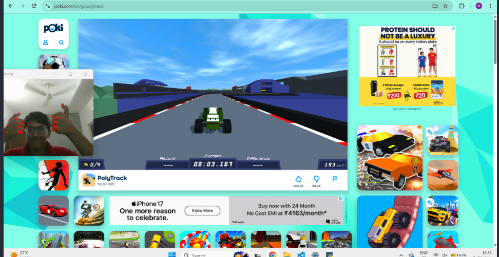

# Car_OpenCV

This project is an attempt to play [PolyTrack](https://poki.com/en/g/polytrack) using your hands and a camera

Tech Stack:
- Python
- MediaPipe
- OpenCV
- My big brain :)

## How to play

- Start the app
- Show your hands and wait for the camera to mark them with dots
- RIGHT HAND GOES FIRST !!
- Make a fist with thumbs open, and wait for it to caliberate
- Thats it !! Youre off

## Controls:

- Press both thumbs down to go back
-  Press Left thumb to restart
- Right thumb to repeat
- Steer like a seering wheel to turn just normally

## Installation guide

- Clone [This repo](https://github.com/MK150710/car_opencv)
- Create a Venv with `python -m venv env` and activate it with `env/Scripts/Activate.ps1`
- `pip install -r requirements.txt` to install all dependencies

Thats all !

## Made with 💗 by Maanvik

P.S: Dont judge my face guys i looks ust as goofy all the time